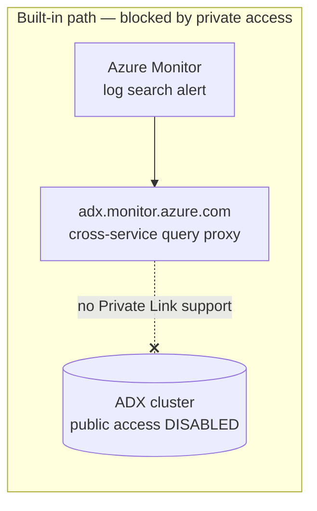
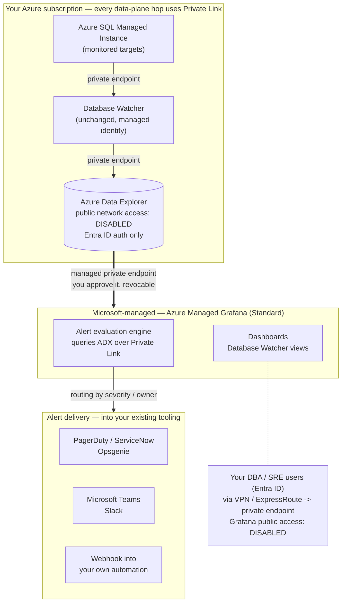
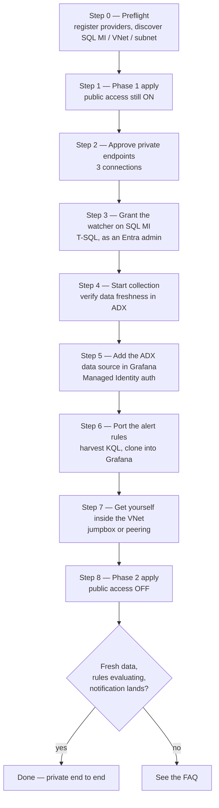

# Private Alerting for Azure SQL Managed Instance

Run **Database Watcher** end to end over **Azure Private Link**, using **Azure Managed
Grafana** as the alert evaluation engine — with the monitoring data store's public
network access switched off.

This is a **concepts and reference** repo: the reasoning, the architecture, the deploy
flow, and the traps. Terraform and PowerShell are included so you can actually build it,
but the README is deliberately about the *why* and the *shape*, not a line-by-line
transcript.

---

## 1. The problem

Database Watcher itself supports private connectivity just fine. You can put managed
private endpoints between the watcher and your SQL MI, the watcher and its Azure Data
Explorer (ADX) data store, and the watcher and Key Vault.

**Alerting is what breaks.**

Database Watcher's packaged alert rules are **Azure Monitor log search alerts**. Those do
not query ADX directly — they go through a Microsoft cross-service query proxy at
`adx.monitor.azure.com`. That proxy **does not support Private Link**, and it is a
[documented product limitation](https://learn.microsoft.com/azure/data-explorer/query-monitor-data#limitations).

So the moment you set `publicNetworkAccess = Disabled` on the ADX cluster, creating or
updating the built-in alert rules fails. For any organisation whose policy forbids public
endpoints on a data store, that blocks adoption outright.



## 2. The fix

Stop making Azure Monitor reach into ADX. Move **only the alert evaluation engine**.

The **Azure Data Explorer Grafana plugin** talks to the cluster's *native data-plane
endpoint* (`https://<cluster>.<region>.kusto.windows.net`), which **does** support Private
Link. Azure Managed Grafana **Standard** supports managed private endpoints to ADX, and
its unified alerting engine evaluates KQL server-side inside Microsoft's managed VNet.

Result: dashboards **and** alert evaluation both travel over Private Link, with ADX public
access off entirely.

> Database Watcher, the watcher resource, and the ADX data store are **unchanged**. The
> same monitoring conditions are covered. Only where the rules are evaluated moves.

---

## 3. Reference architecture



### Security posture in one list

- The ADX cluster has public network access **disabled** — not firewalled, switched off.
- Every data-plane hop uses Private Link on the Microsoft backbone: watcher → SQL MI,
  watcher → ADX, Grafana → ADX, users → Grafana.
- Grafana reaches ADX through a **managed private endpoint mapped to your specific
  cluster**, not to the ADX service — that is the anti-exfiltration control.
- Managed identities and Entra ID throughout. No keys, no secrets to rotate or leak.
- The private endpoint connection sits **Pending until you approve it**, and you can
  revoke it at any time to sever access immediately.
- Monitoring data stays in your subscription and tenant.

---

## 4. What Grafana actually does here

Worth being precise, because "we'll use Grafana" means different things to different
teams. In this design Azure Managed Grafana is **the alerting control plane**, not just a
dashboard tool.

| Capability | What you get |
|---|---|
| **Query ADX privately** | Native Kusto data plane over a managed private endpoint, authenticated with Grafana's managed identity |
| **Evaluate alert rules** | Server-side, scheduled, inside Microsoft's managed VNet — no user session required |
| **Fan out per instance** | **One rule emits one alert instance per `managed_instance_name`** returned by the query. String columns become labels automatically |
| **Route notifications** | Contact points + notification policies by severity, owner, label — into PagerDuty, ServiceNow, Opsgenie, Teams, Slack, or a webhook |
| **Suppress noise** | Silences and mute timings (the equivalent of Azure Monitor alert processing rules) |
| **Dead-man's switch** | `No Data → Alerting`. If collection stops, you get paged. Azure Monitor log search alerts have no equivalent |
| **Dashboards** | The Database Watcher views, over the same private path |
| **Rules as code** | Provisioning API takes alert rules as JSON — version control them |

What it **does not** do:

- **No org-level Grafana Server Admin role and no Grafana RBAC** in the managed service —
  you get org Admin / Editor / Viewer only.
- **Grafana RBAC is separate from Azure RBAC.** Being subscription Owner grants you
  nothing inside the workspace.
- **Alert state history is capped** at roughly 90 days / 10,000 annotations, auto-pruned.
- **No mail server.** See [Notifications](#9-notifications) — this matters, but it is a
  delivery detail, not an architecture blocker.

### The scaling win

Azure Monitor needs separate rules per SQL target type and rule count grows with the
estate. Here, the whole fleet is covered by roughly **19 rules total, not 19 × N
instances**.

Grafana rule quota: **X1 = 500 rules per org, X2 = 1,000**. X1 is ample. (You cannot
downgrade X2 back to X1.)

---

## 5. Cost

Assumes you already own the SQL Managed Instance — that cost is unchanged either way.

| Component | Billing model | Indicative PoC | Notes |
|---|---|---|---|
| **Azure Data Explorer** | Per-node compute + storage, billed while running | **Dominant cost.** A Dev(No SLA) single node is the cheapest way to prove it | Size properly for production, and account for the *added* query load from alert evaluation |
| **Azure Managed Grafana Standard (X1)** | Per-instance hourly **+ per active user** | Low hundreds of USD/month | Standard tier is **required** — Essential does not support alerting or private endpoints |
| **Database Watcher** | No charge for the watcher resource | — | You pay for the ADX cluster underneath it |
| **Managed private endpoints** (Grafana → ADX) | **Free** | — | — |
| **Inbound private endpoints** (users → Grafana, → ADX) | Per-hour + per-GB processed | Cents per day | Standard private endpoint pricing |
| **Jumpbox VM** (optional) | Standard VM pricing | Small B-series | Deallocate when idle — you still pay for the disk, not the compute |
| **Cross-region ADX** (only if you hit a capacity block) | Egress charges | — | PoC unblock only, not a production pattern |

**What you stop paying for:** Azure Monitor log search alert rule execution, billed
**per rule × per target × evaluation frequency**. That is the line item this design
removes, and it is the one that scales badly with the estate.

**Net:** cheaper steady state than the Azure Monitor path once you have more than a
handful of instances — but ADX sizing dominates the bill, so that is where to spend your
review time.

> Always price against the live
> [ADX](https://azure.microsoft.com/pricing/details/data-explorer/) and
> [Managed Grafana](https://azure.microsoft.com/pricing/details/managed-grafana/) pages.

---

## 6. What gets deployed

Assumes an **existing SQL Managed Instance** in the subscription.

| Resource | Purpose |
|---|---|
| ADX cluster + database | Database Watcher data store |
| Database Watcher + target | Collection engine, system-assigned identity |
| 2 × shared private link resources | Watcher → SQL MI, Watcher → ADX |
| Azure Managed Grafana (Standard) | Alert evaluation + dashboards |
| Grafana managed private endpoint | Grafana → ADX, private |
| Private endpoint + private DNS zone | Users → Grafana, private |
| Kusto principal assignments | Watcher = `Admin`, Grafana = `Viewer` |

Optional, off by default:

| Resource | Flag | Why |
|---|---|---|
| ADX private endpoint | `create_adx_private_endpoint` | Lets **humans** run ad-hoc KQL after lock-down. The watcher and Grafana each have their own service-to-service path; neither helps you query the cluster yourself |
| Windows jumpbox | `create_jumpbox` | Something inside the VNet to verify from, once there is no public path |
| VNet peering to an admin VNet | `create_admin_peering` | Reuse a jumpbox you already have |
| Alert-rule user-assigned identity | `create_alert_rule_identity` | The portal's **Alert templates** blade refuses to create any rule until the watcher has one, separate from the watcher's own identity |

There is **no `azurerm_database_watcher` resource**, so the watcher and its children are
created with the **AzAPI** provider.

---

## 7. Deploy — the flow



> **Build with public access ON first.** DNS failures, private endpoint approval failures
> and permission failures all look identical from the outside. Prove the data pipeline
> works, *then* take the public path away.

### Prerequisites

**Tooling**

| Tool | Version | Why |
|---|---|---|
| **PowerShell** | 7.x recommended (Windows PowerShell 5.1 works) | Every script in `scripts/` is PowerShell |
| **Azure CLI** | >= 2.60 | The scripts and the manual steps drive Azure through `az`. Sign in with `az login` and set the right subscription with `az account set --subscription <id>` |
| **Terraform** | >= 1.5 | `azurerm` + `azapi` providers |
| **sqlcmd** | ODBC **Driver 18** | Only for the Step 3 T-SQL grant. Driver 17 cannot complete the TDS handshake |

> The **Az PowerShell module is not required** — nothing here uses `Connect-AzAccount` or
> `Get-Az*` cmdlets. Authentication comes from your `az login` context throughout, which
> also means Terraform, the scripts and your ad-hoc commands all share one identity.

**Azure**

- An **existing SQL Managed Instance**, running
- A subnet for the inbound Grafana private endpoint — **not** the SQL MI delegated subnet
- Permission to create role assignments and register resource providers
- Entra admin access on the SQL MI, to run the T-SQL grant
- A way to reach the VNet — jumpbox, peering or VPN. After Phase 2 there is **no** public
  path to Grafana or ADX, including for you
- A region that supports
  [Database Watcher](https://learn.microsoft.com/azure/azure-sql/database-watcher-overview#regional-availability)

---

### Step 0 — Preflight

```powershell
cd scripts
./preflight.ps1                            # register providers + write terraform.tfvars
./preflight.ps1 -WhatIf                    # report only, change nothing
./preflight.ps1 -SqlMiName sqlmi-prod-01   # when several SQL MIs exist
```

It confirms the subscription, registers the four resource providers that `azurerm` will
**not** auto-register (`Microsoft.DatabaseWatcher`, `Microsoft.Dashboard`,
`Microsoft.Kusto`, `Microsoft.Network`), finds your SQL MI / VNet / delegated subnet,
lists every subnet that **can** host a private endpoint, and writes
`terraform/terraform.tfvars`.

> **Always review the generated file.** When several subnets qualify it takes the first
> and warns you. `terraform.tfvars` is git-ignored — it contains live resource names and
> your subscription ID.

Two sizing decisions to make before applying:

- **ADX SKU availability *and* live capacity are both region-specific.**
  `InsufficientResourcesForSubscription` is regional capacity, not a portal quota, and it
  can affect **every** Kusto SKU in a region at once. If the region is dry, set
  `adx_location` to move **only the cluster** — everything else stays with the SQL MI.
- **Set `streaming_ingestion_enabled = true`.** Database Watcher enables it automatically
  only on a cluster **it creates itself**. Any Terraform or bring-your-own cluster starts
  without it, and the resulting failure is close to invisible. See the FAQ.

### Step 1 — Phase 1 apply, public access on

```powershell
cd ..\terraform
terraform init
terraform plan -out main.tfplan
terraform apply main.tfplan
```

`terraform.tfvars` should have `lock_down_public_access = false` at this point.

### Step 2 — Approve the private endpoint connections

Terraform can *request* private links but **cannot approve them**. That is by design — the
resource owner keeps the veto, which is exactly the control story you want to show a
security team.

```powershell
./scripts/approve-private-endpoints.ps1
```

Approves all three (Watcher → SQL MI, Watcher → ADX, Grafana → ADX). Safe to re-run —
Database Watcher creates its connections asynchronously, so one may still be `Pending` the
first time.

### Step 3 — Grant the watcher access on the SQL MI

Set `@watcherName` at the top of `scripts/grant-watcher-on-sqlmi.sql` to
`terraform output watcher_name`, and run it in `master` as an **Entra administrator**.

> **Do not grant anything extra.** The watcher validates its exact permission set on
> connect and **disconnects if it holds unnecessary permissions**. Adding the login to a
> server role, or granting `db_datareader` "to be safe", breaks collection just as
> reliably as missing permissions.

Four things must be true first, each of which fails with a misleading error:

1. The instance is **running** — a stopped instance cannot accept a private endpoint.
2. The instance has a **managed identity**, or `CREATE LOGIN ... FROM EXTERNAL PROVIDER`
   fails for any name.
3. That identity holds **Directory Readers**. Assigning it needs Privileged Role
   Administrator or Global Administrator.
4. You are connecting as the instance's **Entra admin**.

The MI has no public endpoint, so connect from inside the VNet — or enable a temporary
public data endpoint (port **3342**, plus an NSG rule for your IP) and **revert it
immediately**. Client-side traps are in the FAQ.

Success looks like: no errors, the first verification query returning five permissions,
the second returning **zero rows**.

### Step 4 — Start collection

```powershell
$tf  = "<repo>\SQL-DBWatcher\terraform"
$wid = terraform "-chdir=$tf" output -raw watcher_id

az rest --method post --url "https://management.azure.com$wid/start?api-version=2024-10-01-preview"
az rest --method get  --url "https://management.azure.com$wid`?api-version=2024-10-01-preview" `
  --query "properties.status" -o tsv     # expect: Running
```

> In PowerShell the argument **must be quoted** as `terraform "-chdir=$tf"`. Written bare
> the variable is not expanded. And the `start` POST response echoes the *pre-transition*
> snapshot — re-read `properties.status` rather than trusting the response body.

To **restart** the watcher (needed after enabling streaming ingestion, or after the Kusto
principal assignment is recreated), `stop` then `start`.

#### Verify data is landing — freshness, not row counts

Expect `sqlmi_resource_utilization`, `sqlmi_wait_stats`, `sqlmi_connectivity` and friends
within roughly 10–15 minutes. Row counts only prove data arrived *once*. The check that
means "collection is healthy **right now**" is **age of the newest row**:

```kusto
sqlmi_resource_utilization
| summarize AgeMinutes = datetime_diff('minute', now(), max(sample_time_utc))
```

Expect low single-digit minutes. **Make this your habitual check** — the watcher reporting
`Running` is a control-plane state, not a health signal, and collection can stop while the
status stays green.

> **Tables appearing with zero rows is the expected symptom of a missing Step 3.** The
> watcher creates its schema as soon as it starts, which only proves it can reach the
> cluster.

### Step 5 — Add the ADX data source in Grafana

**First, make sure you can sign in.** Grafana's RBAC is separate from Azure RBAC — being
subscription Owner lands you on *No Grafana Role Assigned*. Terraform grants
`Grafana Admin` to whoever runs it; anyone else goes in
`grafana_admin_extra_principal_ids`. Keep it in Terraform, or the grant disappears on the
next re-apply. Role changes are cached — sign out and back in before concluding it failed.

Then, in the Grafana UI:

1. **Connections → Add new connection → Azure Data Explorer Datasource**
2. **Cluster URL** — paste `terraform output -raw adx_cluster_uri` verbatim
3. **Authentication** — **Managed Identity**
4. **Save & test**

Nothing else to fill in. Terraform already granted Grafana's identity `Viewer` on the
database and `Reader` on the cluster.

> ⚠️ **Do not select "Current User".** It borrows the browser session of whoever is signed
> in. That works while you click around a dashboard, but alert rules are evaluated by a
> background scheduler with **no user session** — so evaluation fails silently. You would
> see healthy dashboards and never get paged. **Managed Identity only.**

> **Save & test can pass against an empty database.** It validates connectivity and
> schema, not data. Confirm rows exist before building anything on top.

### Step 6 — Port the alert rules

Database Watcher ships **19 SQL MI templates**: failed SQL Agent jobs, failed connectivity
probes, geo-replication health, CPU, workers, storage, OOM, blocked processes, blocked
requests, deadlocks, lock/memory/network-IO waits, long transactions, request rate drop,
request timeouts, user errors.

```powershell
./scripts/harvest-alert-template-kql.ps1 -ResourceGroup <rg-holding-the-alert-rules> -OutDir ./alert-templates
./scripts/kql-to-grafana-rules.ps1 -Template template.json -KqlDir ./alert-templates `
  -OutDir ./alert-rules -Post -Grafana $G -Token $tok
```

#### How the concepts map

| Azure Monitor log search alert | Grafana |
|---|---|
| KQL query | ADX data source query, format **Table** |
| Evaluation frequency | Rule group evaluation interval |
| Per-resource alert splitting | Automatic — string columns become **labels** |
| Severity 1/2/3 | `severity` label + notification policy |
| Action group | Contact point + notification policy |
| Alert processing rules | Silences + mute timings |
| *(no equivalent)* | **No Data → Alerting** = free dead-man's switch |

#### Two rule shapes — do not mix them up

This is the single most expensive mistake in the port.

| Shape | Query returns | Reduce | Threshold | `noDataState` |
|---|---|---|---|---|
| **Value-based** | a metric column, unfiltered | `Last` on that column | `IS ABOVE <n>` | `NoData` |
| **Row-presence** | zero or more rows | `Count` | `IS ABOVE 0` | **`OK`** |

**Every harvested Database Watcher template is row-presence** — the threshold is already
baked into the KQL, so the query returns rows only when the condition is *already*
breached. That includes the CPU one, which ends
`| where p90_cpu_utilization >= cpu_threshold_percent`.

Cloning is the practical way to build 19 rules, and cloning a *value-based* rule onto a
*row-presence* query gives you a rule that reduces a column that no longer exists and
compares against a leftover number. It **can never fire, and reports no error**. A rule
that silently cannot fire is worse than no rule, because you believe you are covered.

Set `noDataState: OK` on row-presence rules — zero rows is the healthy state.

Build **one** rule of each shape by hand, export it, then let
`kql-to-grafana-rules.ps1` clone it across every harvested query. It strips the exported
`id` / `updated` / `provenance` / `namespace_uid`, strips the `adx('<uri>/<db>').`
cross-service prefix, and sends `X-Disable-Provenance: true` so the rules stay editable in
the UI.

### Step 7 — Get yourself inside the VNet

Once public access is off, **the operator is locked out too**. Sort this out *before*
flipping the switch, not after.

| Option | Flags | Notes |
|---|---|---|
| **Jumpbox** | `create_jumpbox`, `create_adx_private_endpoint` | Without the ADX private endpoint you can reach Grafana but not query ADX |
| **Peer an admin VNet** | `create_admin_peering`, `admin_vnet_*` | Also links the Grafana private DNS zone. Fails if address spaces overlap — the `10.0.0.0/16` default collides constantly |
| **Point-to-site VPN** | — | Best if you need repeat interactive access |

Prefer `jumpbox_public_ip = false` and drive the VM with `az vm run-command invoke` — no
inbound path at all, which is the better security story and needs no NSG exception.

### Step 8 — Phase 2, lock it down

```powershell
# terraform.tfvars
lock_down_public_access = true
```

```powershell
terraform plan -out main.tfplan; terraform apply main.tfplan
```

This sets `publicNetworkAccess = Disabled` on **both** ADX and Grafana.

The verification that matters is a **comparison**: the same hostname must resolve
differently from outside and from inside the VNet. Proving only the inside half proves
nothing — you have not shown the public path is shut.

```powershell
# From your laptop — expect the public IP, and expect the connection to fail
Resolve-DnsName "<grafana-host>" | Select-Object Name, IP4Address
Resolve-DnsName "<adx-host>"     | Select-Object Name, IP4Address

# From inside the VNet — expect private addresses from the private endpoint subnet
az vm run-command invoke -g <rg> -n <jumpbox> --command-id RunPowerShellScript `
  --scripts "Resolve-DnsName '<grafana-host>' | Select-Object Name,IP4Address | Format-Table | Out-String"

# Both must return Disabled
az grafana show      -g <rg> -n <grafana> --query properties.publicNetworkAccess -o tsv
az kusto cluster show -g <rg> -n <cluster> --query publicNetworkAccess -o tsv
```

Then confirm the pipeline still works end to end: fresh data in ADX from inside the VNet,
dashboards rendering, alert rules evaluating without `Error` / `No Data`, and a
deliberately breached threshold producing a real notification.

> An **HTTP 401 from ADX over the private path is success** — it proves the endpoint is
> reachable and authenticating, which is all you are testing.

> Lock-down does **not** block outbound traffic, so notifications keep working. Contact
> points, webhooks and relays are unaffected.

#### Calling the Grafana API after lock-down

Rules-as-code now has to run from inside the VNet. Rather than copy a service account
token onto the jumpbox, give the jumpbox identity a Grafana role
(`grafana_admin_extra_principal_ids`) and let it authenticate itself with IMDS.

> **The token audience is `https://dashboard.azure.com`**, not `grafana.azure.com` as the
> hostname suggests. The wrong audience yields a perfectly valid-looking token and a flat
> `401` with nothing to indicate why.

---

## 8. Read the plan before every apply

Three resources here are written to by Azure **after** creation. Terraform reads the
server-side value as drift and tries to revert it on the next apply — including an apply
for something completely unrelated. Each one is silent, and each one breaks the solution.

| Resource | What Azure sets | What reverting it does | Handling |
|---|---|---|---|
| Grafana workspace | `api_key_enabled` flips to `true` when you create a service account token | Terraform sets it back to `false` and **invalidates the token** your rules-as-code scripts use | Declare `api_key_enabled = true` explicitly |
| Watcher Kusto principal assignment | The watcher's `principalId` is unknown at plan time | Assignment is **replaced on every watcher change**, opening a window where the watcher cannot write to ADX | `lifecycle { ignore_changes = [principal_id] }` |

The third deserves emphasis: during that window the watcher's status still reads
**`Running`**. Only **data freshness** tells you whether collection is actually working.

**`No changes` is the only safe plan output.**

---

## 9. Notifications

Route alerts where your on-call already lives:

1. **Native integrations** — PagerDuty, ServiceNow, Opsgenie, Teams, Slack, webhook. This
   is where alerts should land anyway.
2. **Webhook → Logic App → Action Group / ITSM** — if you want convergence with an
   existing Azure Monitor estate.
3. **Email** — only if plain mail is a hard requirement. **Azure Managed Grafana does not
   provide an SMTP server**, so the Email contact point needs your own relay (SendGrid or
   internal); Exchange Online generally will not work, because of basic auth deprecation.

`deterministic_outbound_ip_enabled` is on, so `terraform output grafana_outbound_ips`
gives you the addresses to allow-list on the receiving side.

---

## 10. Known limitations

| Issue | Impact | Mitigation |
|---|---|---|
| Entra **SSO redirect still uses the public network**, even with private access | Auth only — no telemetry, no query results traverse it | Disclose it proactively; don't let a security reviewer find it later |
| ADX queries from Grafana **may be slow or return 50x** with many panels on one cluster (throttling) | Alert evaluation flakiness | **Top technical risk — test explicitly.** Table format, short lookback windows, staggered rule groups, size the cluster for the added load |
| AMG supports **only one managed identity** (system *or* user-assigned) | Design decision up front | — |
| Alert state history ~**90 days / 10,000 annotations**, auto-pruned | Long-term audit gap | Forward to SIEM via webhook |
| **Grafana Server Admin role and Grafana RBAC unavailable** in AMG | Org Admin/Editor/Viewer only | Usually sufficient; verify against separation-of-duties requirements |
| `Pin to Grafana` from the Azure portal breaks with private access | Minor UX | Accepted |
| Grafana Enterprise not purchasable on **CSP** subscriptions | Only matters for Enterprise plugins | — |
| **Database Watcher is still public preview** | No SLA on the data source | Unchanged by this design — but be straight about it |

---

## 11. Teardown

```powershell
cd terraform
terraform destroy
```

Shared private link resources and the managed private endpoint are children of the watcher
and the Grafana workspace, so they go with them. Then check for orphaned private endpoint
connections on the **pre-existing SQL MI**, which Terraform does not own:

```powershell
az network private-endpoint-connection list --id "$(terraform output -raw sqlmi_id)" -o table
```

Two more things `terraform destroy` will **not** clean up:

- **The resource group you harvested alert templates from.** Letting the portal generate
  the built-in rules creates real Azure Monitor rules, and those **bill per rule × target ×
  evaluation frequency** for as long as they exist. Delete the group once you have the KQL.
- **The temporary public data endpoint and NSG rule** on the SQL MI, if you used that route
  in Step 3.

To pause rather than destroy, deallocate the jumpbox — a stopped VM still bills for its
disk but not compute:

```powershell
az vm deallocate -g <rg> -n <jumpbox> --no-wait
```

---

## 12. FAQ

Everything that cost real time, grouped by where you hit it.

<details>
<summary><b>Deployment and Terraform</b></summary>

**`API version '2025-01-02' was not found for 'Microsoft.DatabaseWatcher'`**
The resource provider is not registered — the message names an API version, not the real
problem. `azurerm` only auto-registers a fixed set of providers and
`Microsoft.DatabaseWatcher` is not in it. Run `scripts/preflight.ps1`, or
`az provider register --namespace Microsoft.DatabaseWatcher --wait`. Same story for
`MissingSubscriptionRegistration` on `Microsoft.Dashboard`.

**`Subnet ... is delegated to Microsoft.Sql/managedInstances`**
`private_endpoint_subnet_name` points at the SQL MI subnet, which is delegated and cannot
host a private endpoint. `preflight.ps1` lists valid candidates.

**`InsufficientResourcesForSubscription` creating the ADX cluster**
Regional Kusto capacity, not a portal quota — it can affect **every** SKU in a region at
once, so working down the size list is wasted effort. Set `adx_location` to another region;
only the cluster moves. Cross-region egress is billable, so treat it as a PoC unblock.

**Windows Server Azure Edition VM fails to create**
Azure Edition images require automatic guest patching — `patch_mode = "AutomaticByPlatform"`.

**A Grafana service account token stops working after an unrelated `terraform apply`**
Terraform reverted `api_key_enabled` to `false`. Declare it explicitly — see
[Read the plan before every apply](#8-read-the-plan-before-every-apply).

**`terraform output` prints nothing but exits `0`**
You are outside a state directory. Use `terraform "-chdir=$tf"` — quoted, in PowerShell, or
the variable is not expanded.

</details>

<details>
<summary><b>Collection is not working</b></summary>

**Tables exist in ADX but every table has 0 rows, and `.show ingestion failures` is empty**
**Streaming ingestion is disabled on the cluster.** The watcher can run DDL, so the schema
appears, but it never attempts ingestion — hence no failures either. It is auto-enabled
only on a cluster the watcher creates itself, so any Terraform/BYO cluster starts without
it. Set `streaming_ingestion_enabled = true`, then **restart the watcher**. Verify with the
`enableStreamingIngest` property — note the name; `enableStreamingIngestion` silently
returns `null`. *This one cost the most time of anything in the build.*

**Watcher shows Not collecting, no tables appear**
The T-SQL grant was not run, or the watcher holds **extra** permissions. Re-run
`grant-watcher-on-sqlmi.sql` and confirm the login is in **no** server role.

**Collection stops after a permissions change**
Same cause. The watcher disconnects when it holds unnecessary permissions. Remove them.

**Collection silently stops but the watcher still reports `Running`**
The Kusto principal assignment was replaced by an unrelated watcher change. `status` is a
control-plane state, not health — track **data freshness** and add
`ignore_changes = [principal_id]`.

**`sqlmi_active_sessions` stays empty while other tables fill**
Expected on an idle instance — that dataset only records sessions running a request,
blocking, or holding an open transaction. Generate activity:
`BEGIN TRAN; ...; WAITFOR DELAY '00:05:00'; COMMIT;`

**`SharedPrivateLink.Create ... Operation Failed` with no detail**
The SQL MI is stopped. Start it, delete the failed `sharedPrivateLinkResources` child,
re-apply. Note the CLI inconsistency: `az sql mi show` takes `-n`, but `start`/`stop` take
`--mi`.

</details>

<details>
<summary><b>Connecting to the SQL MI for the grant</b></summary>

**`Msg 33134 — Server identity is not configured`**
The SQL MI has no managed identity: `az sql mi update ... --assign-identity --gpv2 true`.
Omit `--gpv2 true` on a General Purpose **V2** instance and the update is rejected with
`GPTargetEditionAndUnspecifiedGPV2NotAllowedInUpdateOFGPV2MI`, because the CLI sends the
SKU on every update.

**`Msg 37353 — Server identity does not have ... Readers permission`**
The MI identity is not in the Directory Readers role. Assigning it requires **Privileged
Role Administrator** or **Global Administrator** — holding Directory Readers yourself only
lets you read the assignment list. Verify via the unified
`roleManagement/directory/roleAssignments` endpoint; the legacy `directoryRoles/{id}/members`
endpoint lags and shows it missing long after it succeeded.

**`prelogin failure` connecting to the MI**
ODBC Driver 17 cannot complete the TDS handshake. Install Driver 18 (SSMS 20, Azure Data
Studio, or `winget install --id Microsoft.Sqlcmd`). go-sqlcmd installs *alongside* the
legacy `sqlcmd` rather than replacing it — confirm which binary you are invoking.

</details>

<details>
<summary><b>Grafana and alert rules</b></summary>

**Grafana shows "No Grafana Role Assigned"**
Grafana RBAC is separate from Azure RBAC — subscription Owner grants nothing. Assign
`Grafana Admin` scoped to the workspace via `grafana_admin_extra_principal_ids`, then sign
out and back in. Propagation can take up to an hour.

**Alert rules never fire, but the panel shows data**
The ADX data source is using **Current User** auth. Background evaluation has no user
session. Change to **Managed Identity**.

**A rule never fires despite a real breach**
Value-based expressions cloned onto a row-presence query — the Reduce step is reducing a
column that does not exist. Reduce `Count`, Threshold `IS ABOVE 0`, `noDataState: OK`. See
[Two rule shapes](#two-rule-shapes--do-not-mix-them-up).

**A rule sits at `Normal` / health `nodata` forever**
Ambiguous by design: either the KQL correctly returns no rows because nothing is wrong, or
the expression chain is broken — both look identical. Query the underlying table directly
and compare the value against the rule's threshold. If it is well inside limits, `nodata`
**is** the healthy steady state for a row-presence rule.

**Alert rules intermittently `Error` / `No Data`**
ADX throttling from concurrent queries. Use Table format, shorten the lookback, stagger
rule groups, scale the cluster. Also check every query has a time bound —
`$__timeFilter(...)` or `ago(...)` — or it scans the full retention window on every
evaluation.

**Grafana API returns `409 duplicate key ... alert_rule_pkey`**
The exported rule you cloned still carries its numeric `id`. Strip `id`, `updated`,
`provenance` and `namespace_uid` before POSTing — `kql-to-grafana-rules.ps1` does this.

**Harvested KQL fails in Grafana**
Azure Monitor rules use cross-service `adx('<uri>/<db>').Table` syntax. Strip the `adx(...)`
prefix; the Grafana data source is already scoped to the database.

**`401` on every Grafana API call with a valid Entra token**
Wrong audience. Request the token for `https://dashboard.azure.com`, not
`grafana.azure.com`. If the identity was just granted its role, expect `401` for a few
minutes while Grafana's cached Azure RBAC catches up.

</details>

<details>
<summary><b>After lock-down</b></summary>

**Grafana data source test fails after `lock_down_public_access = true`**
The managed private endpoint is not approved — run
`scripts/approve-private-endpoints.ps1`.

**Grafana URL unreachable**
Expected: public access is off. Reach it from inside the VNet, and confirm private DNS
resolves to the private IP.

</details>

---

## 13. References

- [Database Watcher overview](https://learn.microsoft.com/azure/azure-sql/database-watcher-overview)
- [Database Watcher alerts](https://learn.microsoft.com/azure/azure-sql/database-watcher-alerts)
- [Database Watcher datasets](https://learn.microsoft.com/azure/azure-sql/database-watcher-data)
- [ADX cross-service query limitations](https://learn.microsoft.com/azure/data-explorer/query-monitor-data#limitations)
- [AMG managed private endpoints](https://learn.microsoft.com/azure/managed-grafana/how-to-connect-to-data-source-privately)
- [AMG private access](https://learn.microsoft.com/azure/managed-grafana/how-to-set-up-private-access)
- [AMG service limits](https://learn.microsoft.com/azure/managed-grafana/known-limitations)
- [ADX Grafana plugin](https://learn.microsoft.com/azure/data-explorer/grafana)
